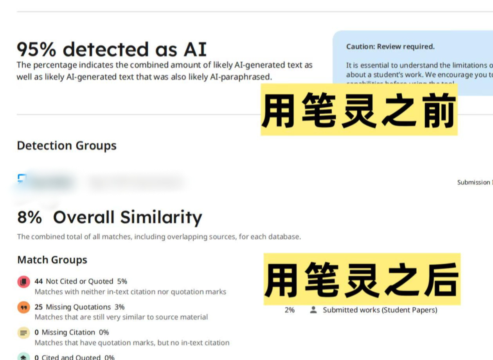
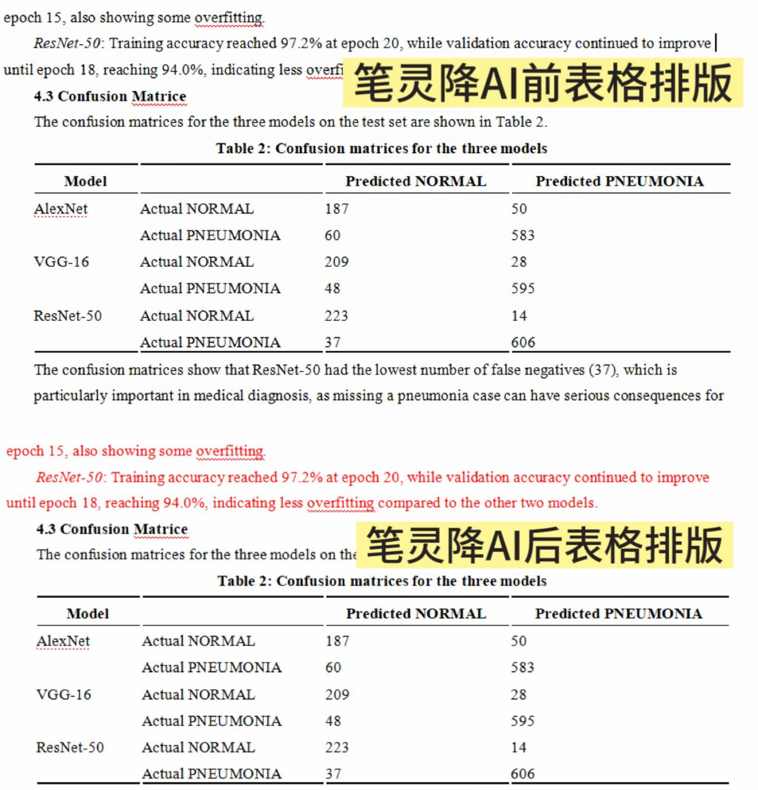
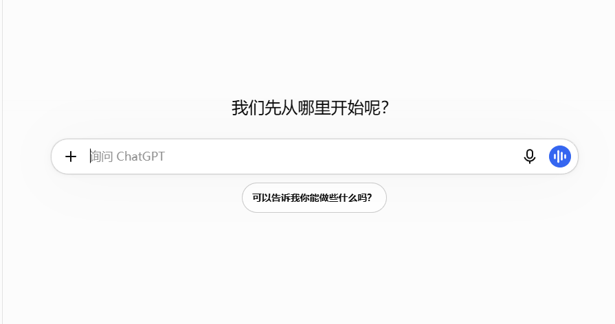

# 英文降 AI 工具怎么选？6款英文降ai率工具实测对比！

一到要处理英文长稿的时候，小伙伴都开始找靠谱的**免费英文降 ai 率工具**了，不少人一开始会优先挑选不用付费的工具，想着低成本完成文本优化，但踩坑之后才发现，市面上这类**英文降aigc工具**的表现差距非常大。

我这段时间一直在做**英文降AI相关**的测试，也试过很多不同类型的产品，这次专门挑选一批有着不同侧重点的改写工具实测，帮大家分清自己适合什么类型的工具。

### 一、深度改写类

#### 1、笔灵

官网：[https://u\.ibiling\.cn](https://ibiling.cn/paper-pass/english?from=githubywjiangai1009jw) 

**优势**：改写不会局限于简单同义词替换，会调整句式排布与语句节奏，让行文更贴近自然表达，改写的效果非常突出。

我比较喜欢的是它可以保留稿件原有排版与专业术语，改写模型也一直在优化，改写后的文本自然度表现稳定。 

相对来说，这款工具可以兼顾**英文降 ai 率**效果和易用性，如果用它来修改英文长文章会省心很多。 

**局限性**：免费版本有字数上限，冷门细分领域专业词汇偶尔识别不准，改写后需要人工核对。

#### 2、[Paraphraser\.org](https://Paraphraser.org)

官网：[https://paraphraser\.org/](https://paraphraser.org/)

**优势**：无需注册，有多档改写强度可以切换，打开网页就能直接上手，不过网站有点不稳定。 

**局限性**：改写偏向表层换词，句子底层结构改动有限，文本自带的模板感依旧明显，面对识别严格的检测，优化效果很难达到预期，长文本处理时还容易出现语句衔接断层。

### 二、纠错润色类

#### 3、Grammarly

官网：[https://www\.grammarly\.com/](https://www.grammarly.com/)

**优势**：老牌英文校对工具，语法、用词校对能力扎实，可以修正文稿里大量基础表达错误，优化语句地道度，适合用来做基础语法检查，很多小伙伴日常写英文内容都会常备这款工具。 

**局限性**：核心定位是语法校对，并不主打深度改写，很难单独依靠它实现明显的表达优化，免费版本的改写功能还有不少限制。它更适合改写完成之后做校对查漏，不能单独依靠它完成整篇稿件的**降低英文 ai 率**。

#### 4、Linguix

官网：[https://linguix\.com/](https://linguix.com/)

**优势**：润色选项丰富，可以给出多种替换表达，支持浏览器插件，边写边调整语句，适合精细化打磨单句用词，调整局部语句的流畅程度。 

**局限性**：改写力度偏弱，只能做小幅度微调。如果段落本身 AI 标记偏高，单靠它很难拿到满意的效果，批量处理长篇稿件的体验一般，只适合收尾微调。

### 三、通读核验类

#### 5、ChatGPT

官网：[https://chat\.openai\.com/](https://chat.openai.com/)

**优势**：长文本承载能力不错，可以一次性导入英文稿件，帮我们梳理段落逻辑，标记模板感重的句子，用来前期筛查文稿，规划改写思路。 

**局限性**：属于通用大模型，改写随机性很强，同一段内容多次改写结果差异很大；手动筛选标记的过程耗时久，偶尔误判内容，筛选之后还需要二次加工。

#### 6、Editpad

官网：[https://editpad\.org/](https://editpad.org/)

**优势**：网页端直接使用，自带改写、字数统计功能，适合短段落快速测试改写思路，快速看一下简单改写之后的文本变化。 

**局限性**：质量不稳定，经常出现搭配错误、逻辑断裂，正式稿件不建议作为主力工具使用，适合随手测试。

### 工具搭配思路小结

免费工具门槛低，上手没有成本，用来通读全文、标记有问题的段落是比较合适的。

但如果直接依靠免费工具完成定稿改写，大多稳定性不足，反复调整很耗费精力，如果只是用来筛查稿件段落，它们可以胜任；想要稳定省心地完成定稿优化，还是需要挑选更加适合自己的工具。

### 实操小要点

不要一次性上传整篇稿件改写，长文本容易生成统一刻板的文风，可以拆成 300–500 词小段分批调整，方便单独把控每一段的句式节奏。 

每改完一段，可以加入少量自己习惯的表达，增加个人行文特点，冲淡标准化的模板痕迹。 

工具仅能优化表达形式，无论用哪款**英文降 AIGC**工具，全部调整结束后，一定要通读全文核对原意，避免改动原本的论证思路哦\~

